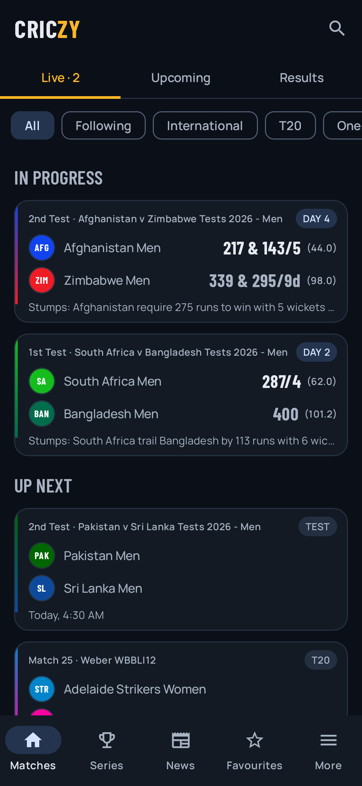
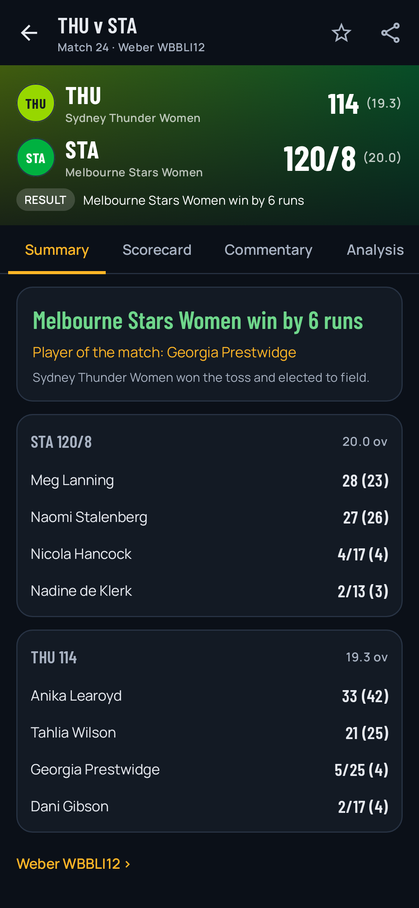
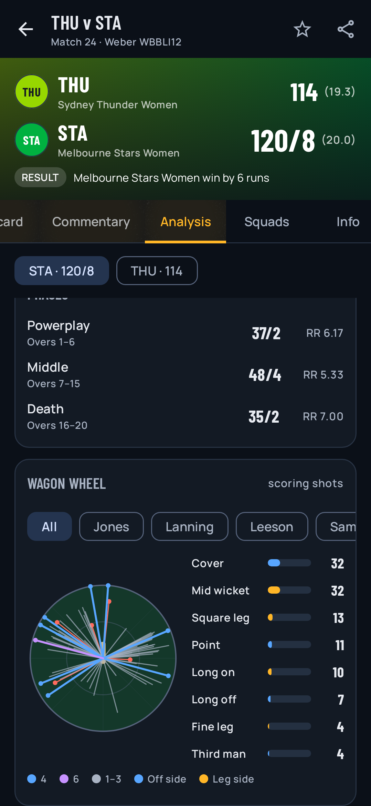

# Criczy

A live cricket app for Android, built to replace Cricpeak: live scores, ball-by-ball commentary, full scorecards and match analysis.

| | | |
|---|---|---|
|  |  |  |

More screenshots are in [docs/screenshots](docs/screenshots). They are produced by the test suite from real captured match data.

## Features

- **Matches**: live, upcoming and finished matches with filters (following, international, T20, one-day, Tests, women), pull to refresh, automatic refresh while a match is live.
- **Match centre**: summary with batters, bowler, partnership, run rate, target and projected total; full scorecard; ball-by-ball commentary with paging and per-ball detail; squads; venue, toss and officials; key moments.
- **Analysis**: worm, Manhattan, scoring breakdown, powerplay/middle/death phases, wagon wheel per batter, pitch map per bowler, partnerships, batter-v-bowler match-ups.
- **Series**: fixtures and results, points table, and leaderboards computed from scorecards.
- **Player comparison**: any two players, over a match or a whole series.
- **Teams, players, news, search, favourites**.
- **Match alerts** for followed teams, series and matches; **home-screen widget**; **scorecard sharing** as an image.
- **Offline**: anything opened before stays readable, with a banner showing it is a saved copy.
- Light and dark themes, phone and tablet layouts, screen-reader descriptions.

Not included: AI predictions and ads (deferred by decision), ICC rankings and career statistics (the data source does not provide them). See [docs/ROADMAP.md](docs/ROADMAP.md).

## Build

Requires JDK 17+ and the Android SDK (platform 36). Create `local.properties` with `sdk.dir=/path/to/sdk`.

```bash
./gradlew :app:assembleDebug
```

```bash
./gradlew test
```

```bash
./gradlew :app:lintDebug
```

Release builds and signing: [docs/RELEASE.md](docs/RELEASE.md).

## Project layout

```
app            UI (Compose), navigation, notifications, widget
core/data      Room, DataStore, repositories, polling, alert logic   (Android library)
core/network   API client behind CricketRemoteDataSource, offline HTTP cache   (pure Kotlin)
core/analytics charts and statistics computed from ball-by-ball data   (pure Kotlin)
core/model     domain types   (pure Kotlin)
```

Dependencies point one way: `app → core:data → core:network / core:analytics → core:model`. Only `core:network` knows which data provider is used.

## Documentation

- [docs/ARCHITECTURE.md](docs/ARCHITECTURE.md) — how the pieces fit and how to add a feature or change provider
- [docs/API.md](docs/API.md) — every endpoint, and what the data cannot support
- [docs/TESTING.md](docs/TESTING.md) — what is tested, how, and what is not
- [docs/RELEASE.md](docs/RELEASE.md) — signing, building and the Google Play checklist
- [docs/PRIVACY_POLICY.md](docs/PRIVACY_POLICY.md) — the policy text to host for Google Play
- [docs/CRICPEAK_AUDIT.md](docs/CRICPEAK_AUDIT.md) — the audit of the original app and how each feature was carried over
- [docs/ROADMAP.md](docs/ROADMAP.md) — what is deferred or blocked

## Data source

Scores, news and images come from cricket.com.au's app API. It is undocumented and not licensed for third-party use; read the note in [docs/API.md](docs/API.md) before publishing. Criczy is not affiliated with Cricket Australia.

## Secrets

Nothing secret is needed to build or run. Signing keys, `keystore.properties` and `google-services.json` are excluded by `.gitignore` and must never be committed.
